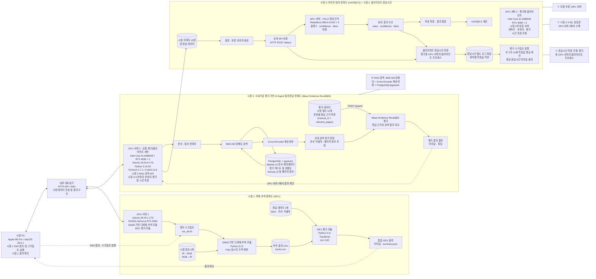

# 통합 시험 환경 구성도

아래 구성도는 앞서 정리한 시험 1(IDF1), 시험 2(RAG+LLM), 시험 3(장비 인식 mAP@0.5), 시험 4(클라이언트 응답시간) 흐름과 추가로 제공한 RAG 검색 API / PostgreSQL + pgvector 구성을 하나로 통합한 것이다.

## 흐름 요약

- **시험 PC**
  - IDF1 시험에서 SSH를 통해 GPU 서버 1에 접속하여 스크립트를 실행하고 터미널 결과를 확인한다.
  - 시험 2·3·4의 평가 및 결과 확인은 GPU 서버 2에서 수행한다.

- **시험 1: 객체 추적 정확도(IDF1)**
  - 시험 영상 2개를 SAM3 기반 다개체 추적 모듈에 입력한다.
  - 추적 결과를 `tracks.csv`로 저장한다.
  - 정답 데이터는 추적 모듈이 아니라 IDF1 평가 모듈에만 입력한다.
  - TrackEval에서 IoU 0.50 기준으로 평가하고 통합 IDF1을 출력한다.

- **시험 2: RAG+LLM 질의응답 정확도**
  - 시험 2는 GPU 서버 2에서 수행하며 결과도 GPU 서버 2에서 확인한다.
  - 평가 데이터의 시험 질의 10개와 문항별 정답 근거 목록을 사용해 `POST /search` 기반 검색 평가를 수행한다.
  - GPU 서버 2의 FastAPI 기반 RAG API가 질의를 전처리한다.
  - BGE-M3로 임베딩 검색을 수행하고 PostgreSQL + pgvector에서 관련 청크를 조회한다.
  - Cross-Encoder로 후보 청크를 재순위화한다.
  - 반환된 상위 검색 청크와 문항별 정답 근거 `(manual_id + relevant_pages)`를 비교하여 Mean Evidence Recall@5를 계산한다.

- **시험 3: 이미지 탐지 정확도(mAP@0.5)**
  - 시험 2와 동일한 GPU 서버 2가 평가용 클라이언트 서버로 동작하며 시험 이미지 15장과 정답 데이터를 관리한다.
  - 원본·부분 이미지를 생성하고 NPU 서버의 `/detect` API로 순차 요청한다.
  - NPU 서버는 YOLO 기반 추론 후 클래스, confidence, bbox를 반환한다.
  - 평가용 GPU 서버가 좌표 복원, 결과 결합, mAP@0.5 계산을 수행한다.

- **시험 4: 클라이언트 응답시간**
  - 시험 2·3과 동일한 GPU 서버 2의 클라이언트 프로세스가 요청·응답 구간의 응답시간을 측정한다.
  - 회차별 응답시간을 별도 로그 파일에 저장한다.
  - 평가 스크립트가 로그 파일의 15회 측정값을 읽어 평균 응답시간을 계산하고 터미널에 출력한다.

