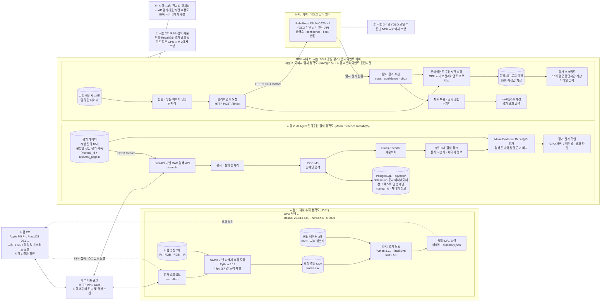

# 통합 시험 환경 구성도

아래 구성도는 시험 1(IDF1), 시험 2(RAG 검색 정확도), 시험 3(장비 인식 mAP@0.5), 시험 4(클라이언트 응답시간)을 하나로 통합한 것이다.

특히 **GPU 서버 2 내부에 시험 2와 시험 3·4의 평가/클라이언트 프로세스를 함께 배치**하여, 시험 2의 RAG 검색 및 평가가 GPU 서버 2에서 수행된다는 점이 명확하게 보이도록 구성하였다.

## 흐름 요약

### 시험 1 — 객체 추적 정확도(IDF1)

- 시험 PC에서 SSH로 GPU 서버 1에 접속한다.
- `run_all.sh`을 실행한다.
- 시험 영상 2개를 SAM3 기반 다개체 추적 모듈에 입력한다.
- 추적 결과를 `tracks.csv`로 저장한다.
- 정답 데이터는 추적 모듈이 아니라 IDF1 평가 모듈에만 입력한다.
- TrackEval에서 IoU 0.50 기준으로 통합 IDF1을 계산한다.
- 시험 PC에서 GPU 서버 1의 터미널 결과를 확인한다.

### 시험 2 — AI Agent 질의응답 검색 정확도

**시험 2의 전체 검색 및 평가 프로세스는 GPU 서버 2 내부에서 수행한다.**

- GPU 서버 2에 시험 질의 10개와 문항별 정답 근거 `(manual_id + relevant_pages)`를 준비한다.
- 평가 데이터에서 RAG 검색 API `/search`로 `POST /search` 요청을 수행한다.
- 질의를 전처리하고 BGE-M3 임베딩 검색을 수행한다.
- PostgreSQL + pgvector에서 dataset-v3의 관련 문서 및 청크를 조회한다.
- Cross-Encoder로 검색 후보를 재순위화한다.
- 상위 5개 검색 청크를 반환한다.
- 검색 결과와 문항별 정답 근거를 비교하여 Mean Evidence Recall@5를 계산한다.
- 평가 결과는 **GPU 서버 2의 터미널 또는 결과 파일에서 직접 확인한다.**

### 시험 3 — 이미지 탐지 정확도(mAP@0.5)

**GPU 서버 2가 평가용 클라이언트 역할을 수행한다.**

- 시험 이미지 15장과 정답 데이터를 사용한다.
- GPU 서버 2에서 원본·부분 이미지 생성 등의 전처리를 수행한다.
- `/detect` API를 통해 NPU 서버로 이미지를 전송한다.
- NPU 서버에서 YOLO 장비 인식 추론을 수행한다.
- 클래스, confidence, bbox 결과를 GPU 서버 2로 반환한다.
- GPU 서버 2에서 좌표 복원 및 결과 결합을 수행한다.
- 정답 데이터와 비교하여 mAP@0.5를 계산하고 결과를 출력한다.

### 시험 4 — 클라이언트 응답시간

**시험 3과 동일한 GPU 서버 2의 클라이언트 프로세스에서 측정한다.**

- GPU 서버 2에서 `/detect` 요청과 응답 사이의 클라이언트 응답시간을 측정한다.
- 각 측정값을 별도 로그 파일에 저장한다.
- 총 15회의 응답시간을 기록한다.
- 평가 스크립트가 로그 파일의 15개 측정값을 읽어 평균을 계산한다.
- 평균 클라이언트 응답시간을 GPU 서버 2 터미널에 출력한다.

## 서버 역할 정리

| 서버 | 시험 | 주요 역할 |
|---|---|---|
| 시험 PC | 시험 1 | SSH 접속, 시험 1 스크립트 실행 및 결과 확인 |
| GPU 서버 1 | 시험 1 | SAM3 추적, TrackEval IDF1 평가 |
| **GPU 서버 2** | **시험 2** | **RAG 검색 API, BGE-M3 검색, Cross-Encoder 재순위화, Mean Evidence Recall@5 평가 및 결과 확인** |
| **GPU 서버 2** | **시험 3** | **NPU 요청 클라이언트, 전처리·후처리, mAP@0.5 평가** |
| **GPU 서버 2** | **시험 4** | **클라이언트 응답시간 측정, 로그 저장, 평균 응답시간 계산** |
| NPU 서버 | 시험 3·4 | YOLO 장비 인식 모델 추론 |
